# AI-Assisted Design of a Flexible Membrane Side-Button Panel for a Tablet PC  

  
  
  
## Introduction  
  
This repository documents the AI-assisted design and manufacture of a five-button flexible membrane-switch panel intended for installation on the side of a tablet PC.  
  
## Design process  
  
Creating drawings in CAD software takes time. For this simple project, I used ChatGPT as a junior engineer and developed the complete design using the V.I.B.E. method—Very Inefficient But Entertaining. In practice, however, I believe that, in this particular case, it was still faster than drawing everything myself.  
  
From this point onward, I let the AI describe what was done, based on the same conversation used throughout the design process.  
  
### Design context and manufacturing constraints  
  
Before starting the keyboard design, I provided screenshots of the LCSC  
custom membrane switch quotation service and asked the AI to understand  
the available manufacturing options and design rules.  
  
Relevant constraints identified during this stage included:  
  
-   PET membrane switch construction  
-   0.125 mm or 0.2 mm PET thickness  
-   Glossy or frosted surface  
-   FPC flexible circuit  
-   Back or front printing  
-   Flat-top or round-top embossed buttons  
-   Regular white or black underlayer  
-   FPC plug-in, soldered, or connector terminal interface  
-   Optional LEDs  
-   3M rear adhesive  
-   1:1 production drawing  
-   Vector artwork with fonts converted to curves/outlines  
-   Back-printed line width greater than 0.25 mm  
-   Supported embossed button diameter: 6--40 mm  
-   Recommended button diameter: 10--14 mm  
-   0.125 mm PET recommended for buttons smaller than 12 mm  
-   Minimum button-to-edge distance: 3 mm  
-   Minimum inter-button distance: 2 mm  
-   Adhesive width greater than 3.5 mm where edge coverage is required  
  
The design was then developed iteratively.  
  
### Iteration 1 - Initial keyboard definition  
  
## Prompt  
  
> Let's start with the design.  
>  
> **PC Flex Keyboard --- side buttons**  
>  
> -   Power, plus, minus, P1, P2  
> -   16 mm × 60 mm  
> -   Black background --- use black from the CMYK and RAL palettes, Jet  
>     Black  
> -   White overlays  
> -   All buttons in one line with equal spacing  
> -   FPC plug-in type connector  
> -   Flex connector underneath the buttons. When bent, it should point  
>     inward toward the center of the keyboard.  
> -   The flex tail should be around 40 mm long.  
> -   It should not reach any edge because the edges will have adhesive  
>     for mounting the keyboard to the device.  
> -   No backlight  
> -   Design according to the LCSC keyboard design guidelines  
> -   Output as a DXF file  
> -   Frosted surface  
> -   Embossed buttons  
  
## Short AI design reasoning  
  
The functional requirements were converted into a manufacturable  
membrane-switch layout.  
  
The panel was fixed at **60 × 16 mm**. Five buttons had to fit in one  
equally spaced row while respecting LCSC edge and inter-button clearance  
requirements.  
  
A 9 mm button diameter was selected. The design used frosted PET, back  
printing, a jet-black background, white graphics, an FPC flexible  
circuit, and an approximately 40 mm FPC tail.  
  
A provisional six-pin interface was defined for Power, Plus, Minus, P1,  
P2, and Common.  
  
## Result  
  
  
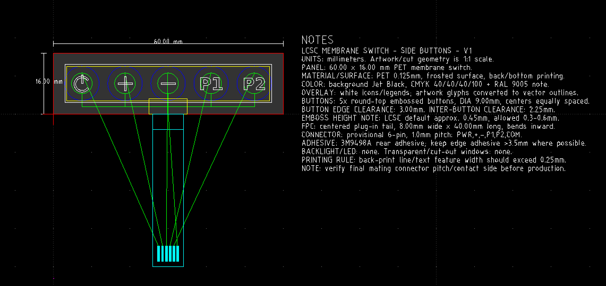  
  
------------------------------------------------------------------------  
  
# Iteration 2 - Vertical mounting interpretation  
  
## Prompt  
  
> It is a pretty good start. Let's iterate around it.  
>  
> -   I want the keyboard to be mounted vertically. Each button symbol  
>     should be rotated 90 degrees to the left.  
> -   P1 and P2 should be slightly smaller and fit inside a smaller  
>     emboss circle.  
> -   Let's call this board `Tablet-PC-side-buttons`.  
> -   Find a mating FPC connector from Molex. Add the exact MPN as an  
>     annotation on the drawing.  
> -   Adhesive should be placed along all edges.  
> -   Add a specific note that there should be adhesive underneath the  
>     FPC cable path, but the FPC cable itself must not be glued to it.  
> -   The FPC should bend back and be guided through a plastic cutout in  
>     the enclosure.  
  
## Short AI design reasoning  
  
The design intent was interpreted as a vertically installed side-button  
strip.  
  
The AI initially rotated the entire panel instead of rotating only the  
button artwork. P1 and P2 were also reduced to smaller emboss circles.  
  
The drawing received a Molex connector annotation and explicit  
adhesive/FPC handling notes. The FPC tail was to remain mechanically  
free so it could bend backward through an enclosure cutout.  
  
## Result  
  
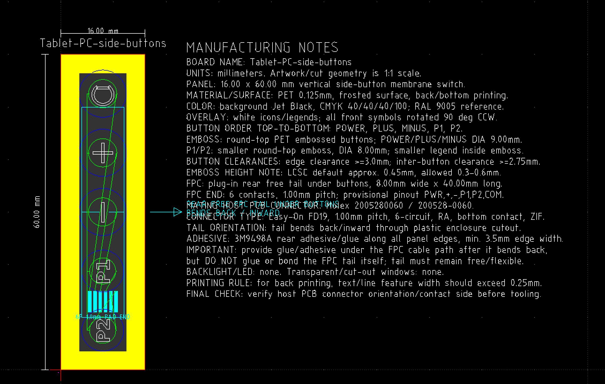  
  
  
## Design issue discovered  
  
The entire keyboard geometry was rotated. This was not the intended  
interpretation.  
  
The panel needed to remain **60 × 16 mm in the original horizontal  
drawing orientation**. Only the button pictograms were supposed to  
rotate.  
  
------------------------------------------------------------------------  
  
# Iteration 3 - Restore horizontal panel orientation  
  
## Prompt  
  
> I don't like that you rotated the whole thing. It was OK before; only  
> the button pictograms were supposed to be rotated.  
  
## Short AI design reasoning  
  
The panel geometry was restored to the original horizontal **60 × 16  
mm** orientation.  
  
Only the button symbols and labels were rotated. The FPC tail, adhesive  
strategy, connector annotation, and membrane construction remained  
unchanged.  
  
## Result  
  
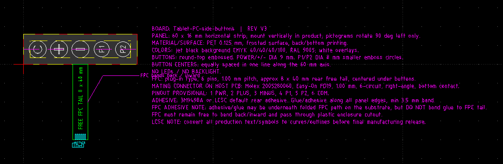  
  
------------------------------------------------------------------------  
  
# Iteration 4 - Correct pictogram orientation  
  
## Prompt  
  
> I like it better. Please rotate each button label 180 degrees.  
>  
> Additionally, fix the power button. It is rotated in the wrong  
> direction and is missing the straight line in the symbol.  
  
## Short AI design reasoning  
  
This iteration focused on the graphic overlay.  
  
The labels were rotated 180 degrees relative to the previous revision.  
The power symbol was redrawn to include the missing straight line and  
its orientation was corrected.  
  
No mechanical or FPC geometry changes were intended.  
  
## Result  
  
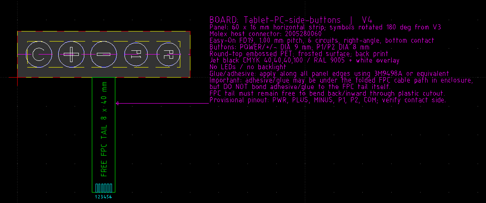  
  
------------------------------------------------------------------------  
  
# Iteration 5 - Finalize button diameter and symbol orientation  
  
## Prompt  
  
> Remove the annotation describing what changed from V3.  
>  
> All buttons must be 9 mm.  
>  
> Rotate Power, P1, and P2 by 180 degrees.  
>  
> Rotate the minus symbol by 90 degrees.  
  
## Short AI design reasoning  
  
The design was normalized to use **five 9 mm embossed buttons**,  
simplifying the mechanical specification.  
  
The artwork orientation was adjusted individually:  
  
-   Power: rotated 180°  
-   P1: rotated 180°  
-   P2: rotated 180°  
-   Minus: rotated 90°  
  
Temporary revision commentary was removed from the production drawing.  
  
## Result  
  
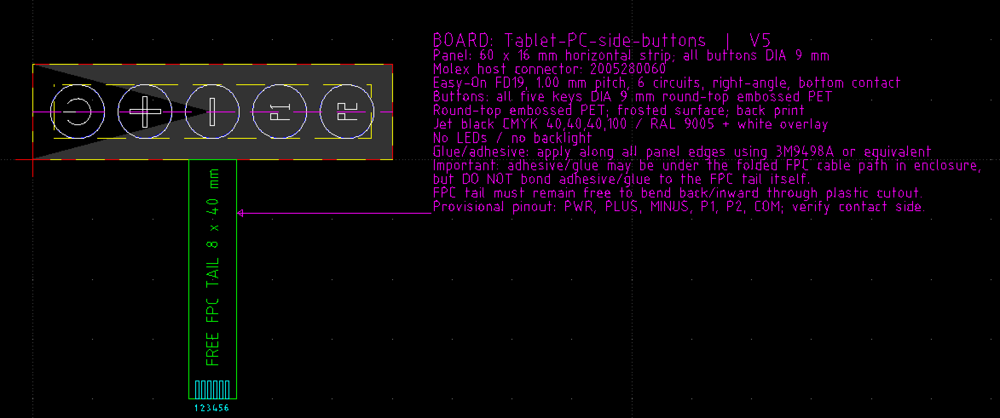  
  
------------------------------------------------------------------------  
  
# Iteration 6 - Add enclosure mounting reference  
  
## Prompt  
  
> Great! Please add an additional drawing showing the part of the device  
> where this keyboard is supposed to be mounted.  
>  
> -   60 × 16 mm indent  
> -   Rectangular hole: 10 × 2 mm  
> -   Hole positioned 2 mm away from the edge  
> -   Hole aligned with the FPC position  
>  
> I want to make it clear that the FPC is supposed to bend freely away  
> from the edge.  
  
## Short AI design reasoning  
  
A separate enclosure reference drawing was added to communicate the  
mechanical installation concept.  
  
It shows a **60 × 16 mm keyboard mounting indent** and a **10 × 2 mm FPC  
pass-through slot** aligned with the membrane tail and positioned 2 mm  
from the relevant inner edge.  
  
The purpose is to document that the FPC must remain free to bend away  
from the adhesive edge and pass through the enclosure cutout.  
  
## Result  
  
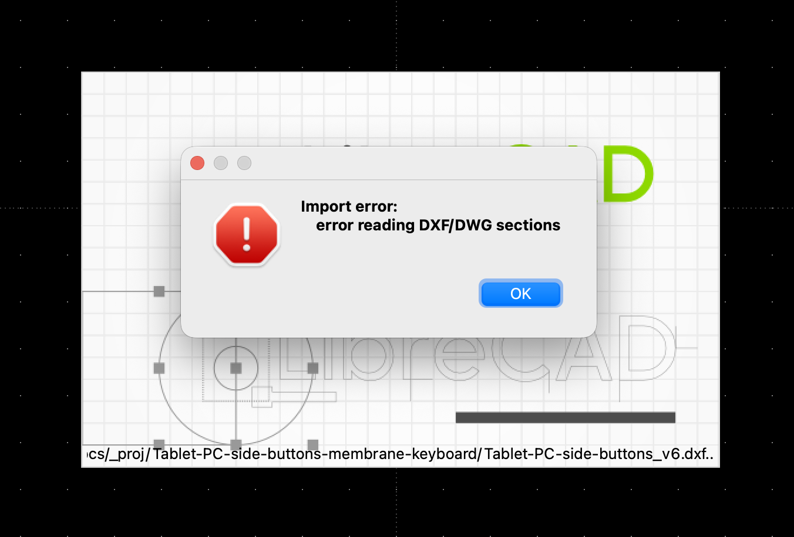  
  
  
------------------------------------------------------------------------  
  
# Iteration 7 - DXF repair and manufacturing specification cleanup  
  
## Prompt  
  
> PNG looks OK, but the DXF is somehow damaged --- "problem reading DXF  
> sections". Please fix it.  
>  
> A few additional notes should be added to the drawing:  
>  
> -   Thickness should be 0.125 mm  
> -   Embossed buttons with flat tops  
> -   Regular white underlayer  
  
## Short AI design reasoning  
  
The previous DXF contained a malformed section terminator introduced  
while adding the enclosure reference.  
  
The drawing was rebuilt from the last structurally valid DXF and the  
enclosure geometry was re-added with a clean DXF entity structure.  
  
The manufacturing specification was clarified to explicitly state  
**0.125 mm PET**, **flat-top embossed buttons**, and a **regular white  
underlayer**.  
  
## Result  
  
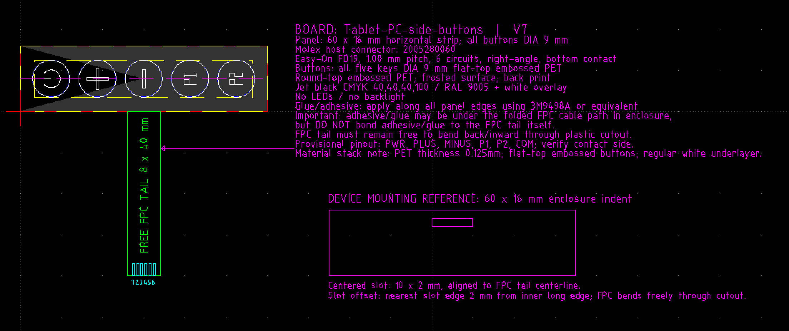  
  
  
  
# Iteration 8 - Human last correction  
  
As the last step I’ve made one correction myself, as further explanation what have to be done would be more time consuming. I’ve removed the infill with weird indent.   
  
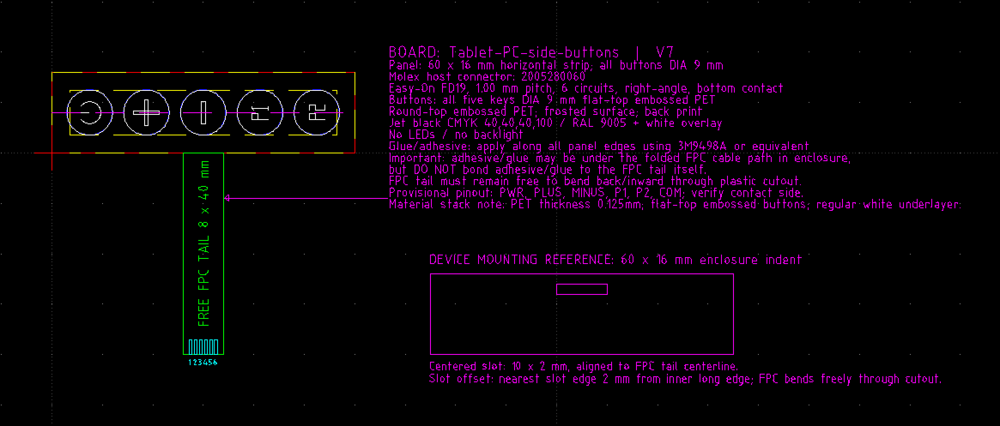  
  
  
## LCSC order  
  
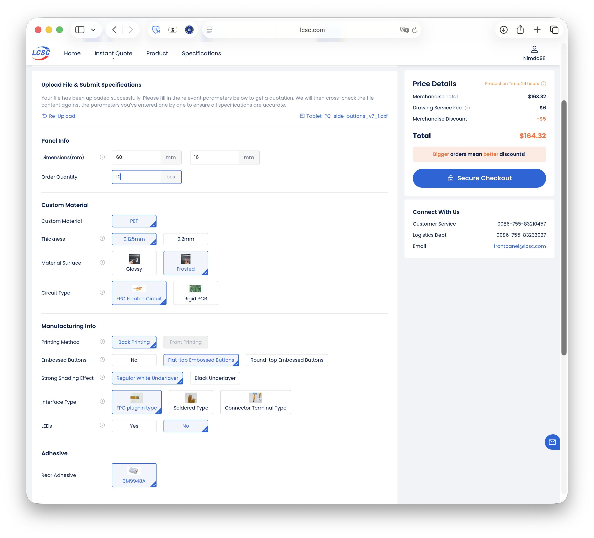  
  
  
------------------------------------------------------------------------  
  
# Iteration 9 - Manufacturer review and FPC contact-side clarification  
  
After the design files were submitted, the LCSC panel team performed a  
manufacturing review and requested clarification about the FPC gold  
finger orientation.  
  
## Manufacturer question  
  
The manufacturer asked whether the exposed gold finger contact side  
should face the same direction as the front graphic overlay or the back  
of the membrane panel.  
  
## Response  
  
I confirmed that the gold finger contact side should be on the **same  
side as the front view of the panel**.  
  
## Design significance  
  
This detail had not been defined clearly enough in the original drawing.  
The clarification established the FPC contact orientation required for  
the selected connector and prevented the tail from being manufactured  
with the contacts on the wrong side.  
  
The final production documentation should therefore state explicitly:  
  
- Gold finger contact side: same side as the panel front view  
- Connector orientation: compatible with the selected host connector  
- FPC insertion direction: as shown in the final assembly drawing  
  
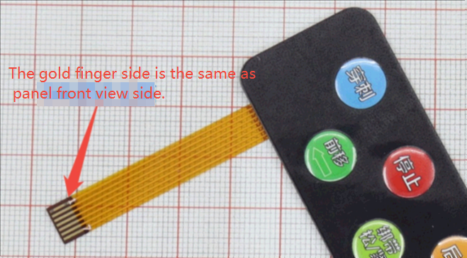  
  
------------------------------------------------------------------------  
  
# Iteration 10 - Clarification of the FPC tail length datum  
  
## Manufacturer question  
  
The manufacturer asked whether the specified **40 mm FPC length**  
included the section where the tail joins the membrane-switch panel.  

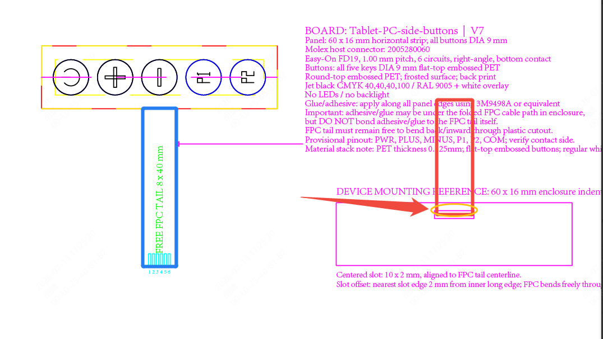  
  
## Response  
  
I clarified that the 40 mm dimension should be measured **from the edge  
of the keyboard panel**.  
  
## Result  
  
The production drawing was interpreted as having an FPC tail extending  
40 mm from the panel edge to the end of the exposed-contact section.  
  
This clarification was important because the original phrase  
“approximately 40 mm long” did not define a measurement datum. For the  
final design, the dimension should be written unambiguously as:  
  
> FPC tail length: 40 mm, measured from the keyboard panel edge to the  
> end of the tail.  
  
  
------------------------------------------------------------------------  
  
# Iteration 11 - Manufacturer manufacturing preview, circuit review, and FPC width correction  
  
After clarifying the FPC contact side and tail-length datum, LCSC  
prepared an effect diagram and circuit-layout preview for approval.  
  
## Manufacturer review  
  
The manufacturer explained that:  
  
- The yellow circles represented the embossed-button dimensions and  
  would not be printed.  
- The pink lines represented the cable outlet on the rear side of the  
  panel.  
- The background would be completely black.  
- The button graphics would be white.  
- The proposed circuit arrangement was shown in the attached production  
  preview.  
  
During the same review, LCSC noticed that the drawing specified an  
8.0 mm FPC tail width while also referencing the Molex `2005280060`  
host connector. They advised that the tail should instead be  
**7.0 mm wide**.  

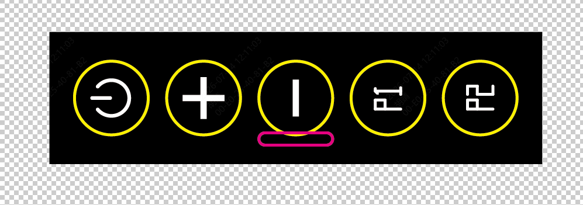  
  
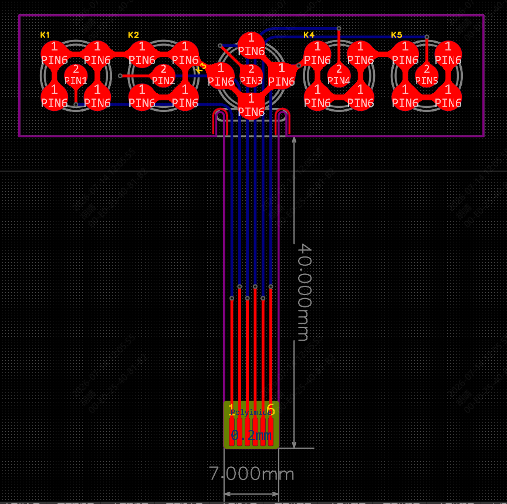  
  
## Response  
  
I confirmed that:  
  
1. The yellow emboss references were correct.  
2. The rear cable outlet was correct.  
3. The black background and white graphics were correct.  
4. The FPC interface should match the Molex `2005280060` connector.  
5. The 8 mm tail width was a mistake and should be changed to 7 mm.  
  
I then approved the effect diagram for production.  
  
## Final production values confirmed during this interaction  
  
- Host connector reference: Molex `2005280060`  
- Number of FPC contacts: 6  
- Contact pitch: 1.0 mm  
- FPC tail width: 7.0 mm  
- Background: black  
- Graphics: white  
- Emboss-reference circles: not printed  
- Cable outlet reference: rear side of the panel  
  

  
  
## Received keyboard  
  
  
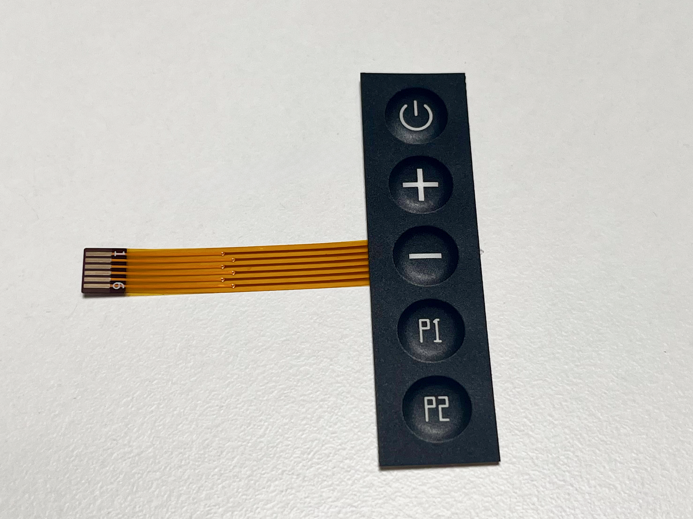  
  
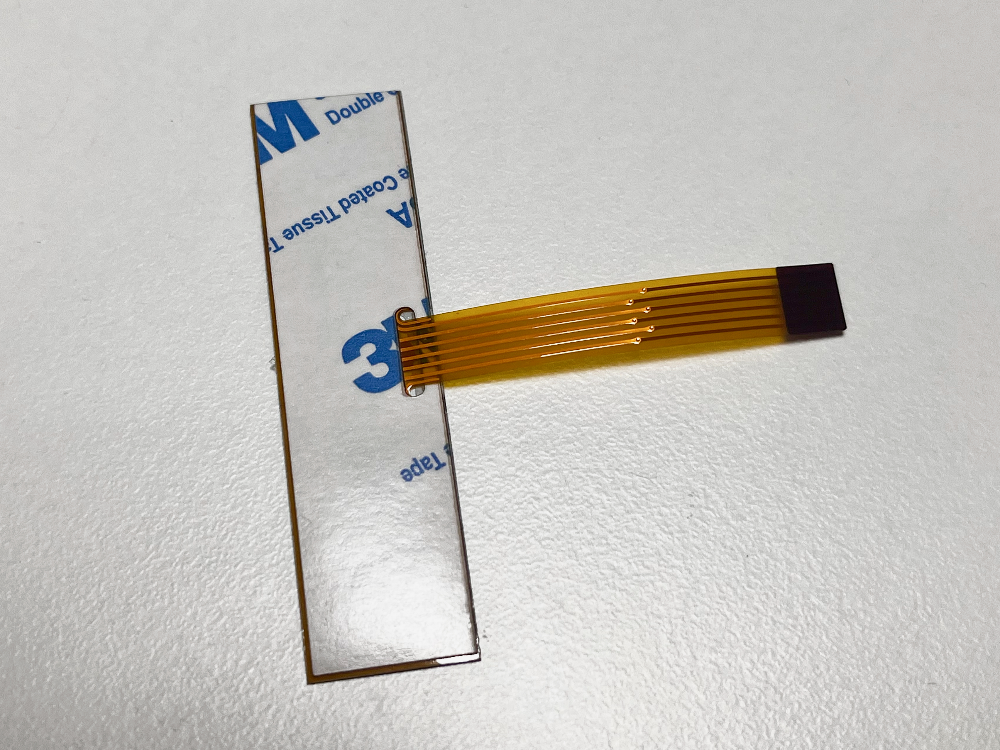  
  
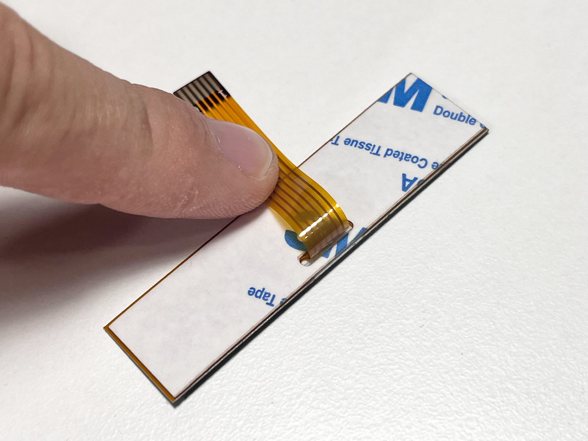  
  
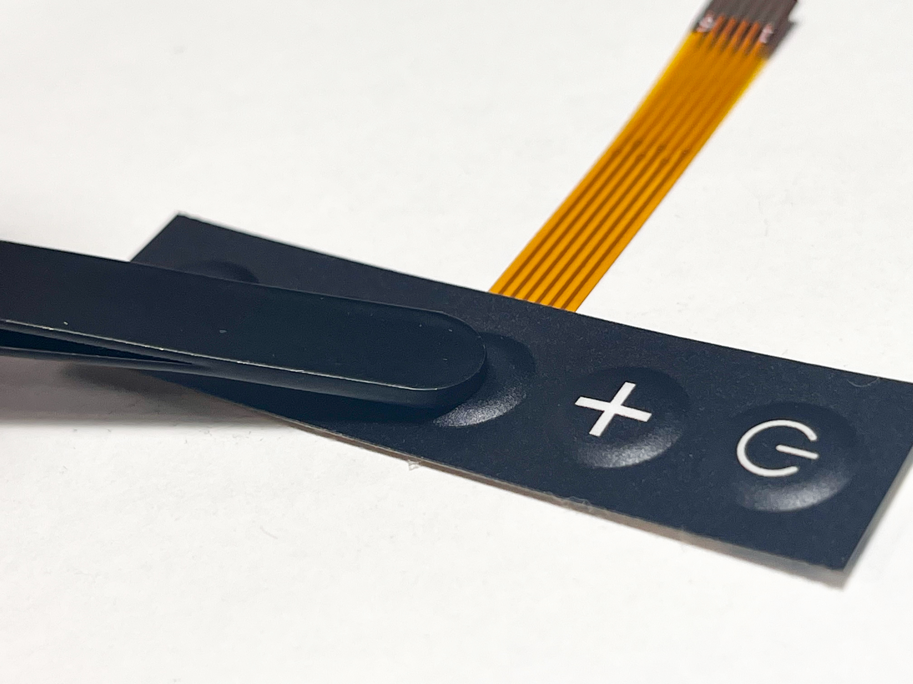  
  
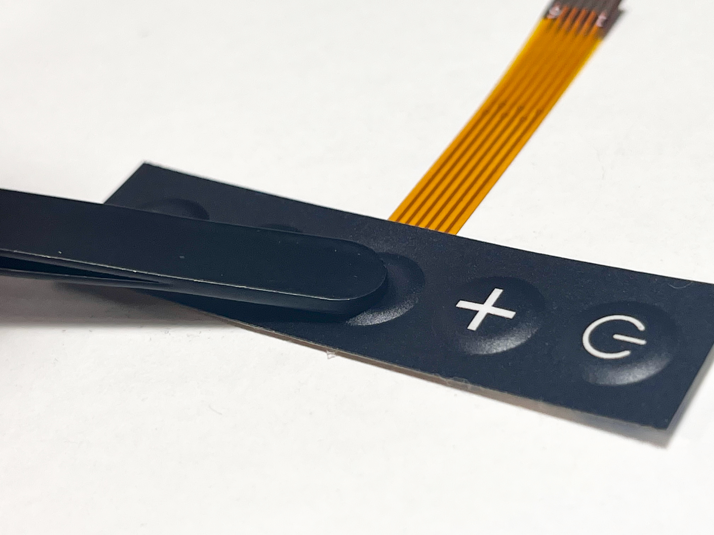  
  
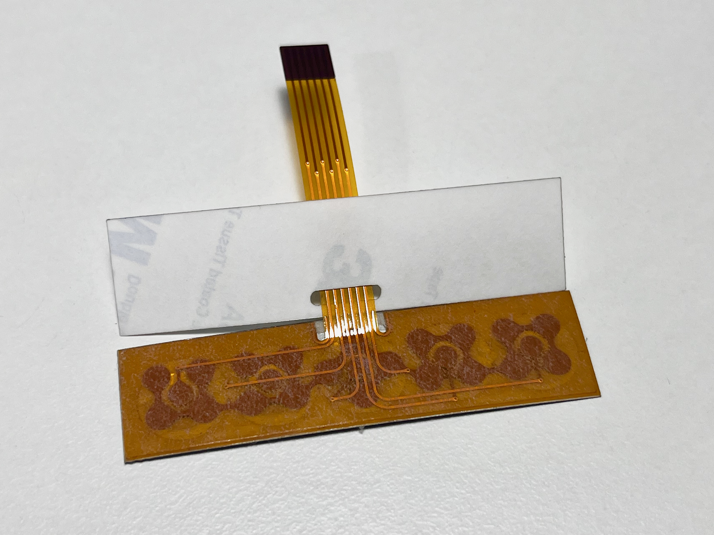  
  
  
## Summary and conclusions  
  
Overall the keyboards went out pretty good. I have no complains to the received keyboards. Language model did pretty good job designing drawing of the keyboard. I’m pretty surprised how good it handled the assignment. For simple design like this one it was much quicker to make a few prompts than drawing it by myself.   
  
  
  
